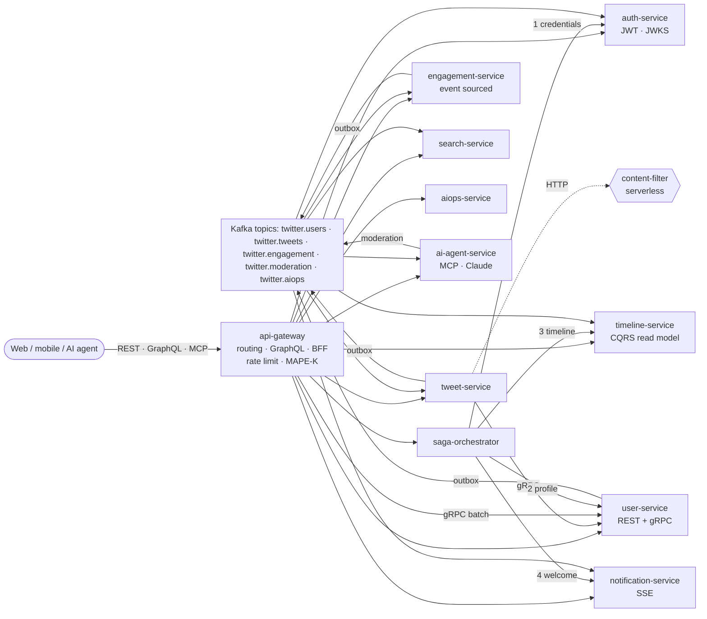

# Twitter — a Service-Oriented Software Engineering reference system

A Twitter clone built as **11 FastAPI microservices + 1 serverless function**. It is designed so that each of the
14 SOSE course topics (SOA → microservices → APIs → events → distributed data → coordination → service mesh →
cloud → resilience → observability → security → adaptation → AI-native services) appears in **running,
tested code**.

* **3 API styles:** REST (FastAPI/OpenAPI), **gRPC** (contract-first `.proto`, unary + batch + server-streaming), **GraphQL**
* **Event-driven:** CloudEvents on **Kafka** (or the in-memory bus or **Dapr** pub/sub), transactional outbox, idempotent consumers, DLQ
* **Distributed data:** database-per-service, **Saga** (orchestrated, with compensation and crash recovery), **CQRS**, **Event Sourcing**
* **Cloud-native:** Docker, Kubernetes Helm chart, **Istio** (mTLS, authorization, retries, outlier detection, canary), **KEDA**, **Dapr**, **Knative** function
* **Operations:** circuit breakers, retries, bulkheads, chaos injection, **OpenTelemetry → Jaeger**, **Prometheus/Grafana**, an **AIOps** anomaly detector
* **Zero trust:** RS256 JWT + JWKS, OAuth2 client-credentials for every service, scoped internal APIs, gRPC auth, network policies
* **Self-adaptive:** MAPE-K loops in the gateway (brownout and load shedding) and in the timeline service (adaptive fan-out)
* **AI-native:** an **MCP server** that exposes Twitter as tools for agents, a **Claude** agent, and AI moderation as an event consumer

---

## Architecture



| Service | Port | Owns | Talks via | Course topics shown |
|---|---|---|---|---|
| `api-gateway` | 8000 | — | REST proxy, GraphQL, gRPC client | 2, 3, 10, 12, 13 |
| `auth-service` | 8001 | credentials, signing keys | REST, events | 12 |
| `user-service` | 8002 / gRPC 50051 | profiles, follow graph | REST, **gRPC**, outbox | 3, 5 |
| `tweet-service` | 8003 | tweets | REST v1+v2, gRPC client, outbox | 3, 5, 9, 10 |
| `timeline-service` | 8004 | home-timeline projection | events in, REST out | 4, 6, 13 |
| `engagement-service` | 8005 | likes/retweets **event store** | REST, outbox | 6 |
| `notification-service` | 8006 | notifications | events in, REST, SSE | 4, 7 |
| `search-service` | 8007 | in-memory index (rebuilt from the log) | events in, REST | 4, 6 |
| `saga-orchestrator` | 8008 | saga log | REST (orchestration) | 5, 6, 7, 10 |
| `aiops-service` | 8009 | anomaly history | scrapes `/metrics`, events | 11 |
| `ai-agent-service` | 8010 | — | **MCP**, Claude API, events | 14 |
| `content-filter` | 8011 | — | serverless function (Knative) | 9 |

`libs/common` (`twitter_common`) is the **microservice chassis**: events, event bus, outbox/inbox, resilience,
observability and security. It contains no business logic.

---

## Requirements

What you need depends on how you run the system. Option A is enough for development, the demo and the tests.

| To… | You need |
|---|---|
| **Run everything locally** (Option A), run the demo and the tests | **Python 3.12** (3.11 is the minimum, but the project is developed and tested on 3.12), `pip`, `git`, and about 300 MB of free disk for the virtual environment. No Docker, database or Kafka needed. |
| **Run the production-like stack** (Option B) | **Docker Desktop** (or Docker Engine) with **Docker Compose v2**, with at least 4 GB of memory assigned to Docker |
| **Deploy to Kubernetes** (Option C) | A cluster (kind, minikube, Docker Desktop k8s or a cloud cluster), `kubectl`, **Helm 3**. Optional add-ons the chart can use: **Istio** (mesh, mTLS), **KEDA** (Kafka-lag autoscaling), **Knative Serving** (the serverless function), **Dapr** (`--set dapr.enabled=true`) |
| **Use Claude-powered AI features** | An Anthropic API key in `ANTHROPIC_API_KEY`. It's optional: without it the AI endpoints use deterministic fallbacks. |
| **Change the gRPC contract** | `grpcio-tools` (already in `requirements-dev.txt`) for `make proto`; [`buf`](https://buf.build/docs/installation) for `buf lint` / `buf breaking` |

**Free ports.** Option A uses ports 8000–8011 (HTTP) and 8051 (gRPC). If they are taken, set `DEVSTACK_BASE_PORT=18000`
to shift them all. Option B also uses 3000, 8080, 9090, 16686, 19092 and 50051.

**Python packages** are all installed by `requirements-dev.txt`:
* **Shared library** (`libs/common/pyproject.toml`, used by every service): FastAPI, Uvicorn, httpx, Pydantic,
  SQLAlchemy (aiosqlite / asyncpg), aiokafka, gRPC + protobuf, PyJWT, Prometheus client and OpenTelemetry.
* **Extra packages for some services:** Strawberry GraphQL for the gateway, and the Anthropic SDK and MCP SDK for the
  AI agent. These are listed in those services' `requirements.txt`.
* **Developer tools:** grpcio-tools, pytest and ruff.

> **macOS tip:** `python3` may point to an older Python. Check it with `python3 --version`. If it isn't 3.12, install it
> (`brew install python@3.12`) and create the environment with `python3.12` as shown below.

---

## Quick start

### Option A: whole system in one process (no Docker, about 10 seconds)

Run every command from the repository folder (`cd twitter`).

```bash
git clone https://github.com/nour-awad/twitter.git && cd twitter
```

```bash
python3.12 -m venv .venv && .venv/bin/pip install -r requirements-dev.txt
```

```bash
.venv/bin/python scripts/devstack.py
```

Every service still runs as its own FastAPI app on its own port, and they still talk over real HTTP and gRPC.
Only Kafka is swapped for an in-memory broker, and each service gets a private SQLite file in `./data`.

* Swagger: http://localhost:8000/docs · GraphQL IDE: http://localhost:8000/graphql · MCP: http://localhost:8000/mcp
* Each service also has its own `/docs`, for example http://localhost:8003/docs

In a second terminal, run the walkthrough that exercises every topic:

```bash
.venv/bin/python scripts/demo.py
```

### Option B: production-like stack with Docker Compose

```bash
docker compose up --build
```

This starts 12 service containers plus Kafka (Redpanda), Postgres (one database per service), Jaeger, Prometheus
and Grafana.

| URL | What |
|---|---|
| http://localhost:8000/docs | API gateway |
| http://localhost:8080 | Redpanda console: watch the events flow through the topics |
| http://localhost:16686 | Jaeger: one trace follows a request across HTTP, gRPC **and** Kafka |
| http://localhost:9090 | Prometheus (SLO alerts in `deploy/prometheus/alerts.yml`) |
| http://localhost:3000 | Grafana: "Twitter microservices — RED & resilience" dashboard |

To enable Claude-powered features, set `ANTHROPIC_API_KEY` before `docker compose up`. Without it, the AI endpoints
fall back to deterministic logic.

### Option C: Kubernetes

```bash
helm install twitter deploy/helm/twitter -n twitter --create-namespace
```

```bash
kubectl apply -f deploy/knative/content-filter.yaml
```

The chart includes Deployments with probes and a hardened `securityContext`, HPA or KEDA (Kafka-lag) autoscalers,
PodDisruptionBudgets, NetworkPolicies, and Istio PeerAuthentication (STRICT mTLS), AuthorizationPolicies,
DestinationRules (outlier detection, connection pools), VirtualServices (timeouts, retries, canary) and an ingress
Gateway. Pass `--set dapr.enabled=true` to route events through Dapr (`deploy/dapr/components.yaml`).

---

## Using the API

```bash
# Register: runs the 4-step registration saga
curl -X POST localhost:8000/api/v1/register -H 'content-type: application/json' \
  -d '{"username":"alice","email":"alice@example.com","password":"s3cret-pass"}'

# Log in and keep the JWT
TOKEN=$(curl -s -X POST localhost:8000/api/v1/auth/login -H 'content-type: application/json' \
  -d '{"username":"alice","password":"s3cret-pass"}' | python3 -c 'import sys,json;print(json.load(sys.stdin)["access_token"])')

# Tweet, then read the timeline (CQRS read model, eventually consistent)
curl -X POST localhost:8000/api/v1/tweets -H "authorization: Bearer $TOKEN" -H 'content-type: application/json' \
  -d '{"text":"Hello #microservices"}'
curl localhost:8000/api/v1/timelines/home -H "authorization: Bearer $TOKEN"
```

<details><summary>Main REST routes (all through the gateway, under <code>/api</code>)</summary>

| Method & path | Service |
|---|---|
| `POST /v1/register` · `GET /v1/sagas/{id}` | saga-orchestrator |
| `POST /v1/auth/login` · `POST /v1/auth/token` · `GET /v1/auth/me` | auth |
| `GET /v1/users/{id}` · `GET /v1/users/by-username/{u}` · `PATCH/DELETE /v1/users/me` · `POST/DELETE /v1/users/{id}/follow` | user |
| `POST /v1/tweets` · `GET /v1/tweets/{id}` (deprecated) · `GET /v2/tweets/{id}` · `DELETE /v1/tweets/{id}` · `GET /v1/users/{id}/tweets` | tweet |
| `POST/DELETE /v1/tweets/{id}/like` · `/retweet` · `GET /v1/tweets/{id}/engagement[?as_of_version=N]` · `/engagement/events` | engagement |
| `GET /v1/timelines/home` · `GET /v1/timelines/users/{id}` · `GET /v1/timelines/adaptation` | timeline |
| `GET /v1/notifications` · `GET /v1/notifications/stream?access_token=…` (SSE) | notification |
| `GET /v1/search/tweets?q=` · `GET /v1/search/users?q=` · `GET /v1/trends` | search |
| `GET /v1/bff/tweets/{id}` · `GET /v1/adaptation` · `GET /v1/gateway/upstreams` | gateway itself |
| `GET /v1/aiops/health` · `/anomalies` · `POST /v1/aiops/analyze` | aiops |
| `POST /v1/ai/agent` · `/timeline-summary` · `/compose` · `GET /v1/ai/tools` | ai-agent |

</details>

**GraphQL** (`POST /graphql`; one gRPC `BatchGetUsers` call resolves every author):

```graphql
query { homeTimeline(limit: 10) { text likeCount author { username followersCount } engagement { likedBy } } }
mutation { postTweet(text: "from GraphQL #api") { id } }
```

**MCP**: connect any MCP client (Claude Code, Claude Desktop, IDEs) to the Twitter tools:

```bash
claude mcp add --transport http twitter http://localhost:8000/mcp --header "Authorization: Bearer $TOKEN"
```

Tools: `search_tweets`, `get_home_timeline`, `get_user_profile`, `get_trending_hashtags`, `post_tweet`, `like_tweet`,
`follow_user`, `get_system_health`. Each tool runs with the caller's own token.

---

## Where each course topic lives

Every row links the research question to code you can open and run. [`docs/course-map.md`](docs/course-map.md)
discusses each one in depth (trade-offs and experiments to try).

| Week | Topic | Implementation |
|---|---|---|
| 1 | Evolution SOA → Microservices → Cloud-Native | [`docs/architecture.md`](docs/architecture.md) compares the same system as an ESB-style SOA, as microservices and as cloud-native; the three run modes (devstack → compose → k8s) mirror that evolution |
| 2 | Microservice principles, patterns & anti-patterns | Database per service, API gateway, BFF, chassis (`twitter_common/service.py`), strangler-ready routing table; anti-patterns avoided are listed in `docs/architecture.md` |
| 3 | REST, GraphQL, gRPC & contract-first | `proto/…/user.proto` (source of truth, `buf` lint/breaking), `contracts/openapi/*.json`, `contracts/asyncapi.yaml`, `/v1` vs `/v2` tweets with `Deprecation`/`Sunset` headers, `api_gateway/graphql_api.py` |
| 4 | Event-driven architecture | `twitter_common/events.py` (CloudEvents contracts), `bus.py` (Kafka / in-memory / Dapr), consumers in timeline, notification, search, engagement and auth |
| 5 | Distributed transactions & consistency | `twitter_common/outbox.py` (transactional outbox, idempotent inbox), at-least-once delivery with DLQ, eventual consistency in read models |
| 6 | Saga, CQRS, Event Sourcing | `saga_orchestrator/main.py`, `timeline_service/main.py` (CQRS), `engagement_service/main.py` (event store, snapshots, temporal queries, optimistic concurrency), search index replayed from the log |
| 7 | Orchestration vs choreography | Registration = **orchestrated** saga; account deletion, notifications and moderation = **choreographed** via events |
| 8 | Service mesh | `deploy/helm/twitter/templates/istio.yaml`; `RESILIENCE_MODE=app\|mesh` switches retries between application and sidecar |
| 9 | Cloud-native: containers, Kubernetes, serverless, Dapr | `deploy/docker/Dockerfile`, `docker-compose.yml`, Helm chart, KEDA, `functions/content-filter` + Knative, `deploy/dapr/` + `DaprEventBus` |
| 10 | Resilience & self-healing | `twitter_common/resilience.py` (timeout, retry with jitter, circuit breaker, bulkhead, supervisor), fallbacks in tweet-service and the BFF, probes, saga crash recovery, `PUT /internal/chaos` |
| 11 | Observability, tracing & AIOps | `twitter_common/observability.py` (RED metrics, OTel across HTTP/gRPC/Kafka, JSON logs with trace ids), Grafana dashboard, alert rules, `aiops_service` (EWMA anomaly detection and topology-based root cause) |
| 12 | Security & zero trust | `auth_service` (RS256, JWKS, key rotation, client credentials), `twitter_common/security.py` (every service verifies, scoped `/internal`, gRPC auth), Istio mTLS and AuthorizationPolicies, NetworkPolicies, non-root read-only containers |
| 13 | Self-adaptive, elastic, autonomous | `api_gateway/adaptation.py` (MAPE-K: brownout, load shedding, adaptive rate limit), adaptive fan-out threshold in timeline, HPA and KEDA |
| 14 | AI-native SOA: agents, tool services, MCP | `ai_agent_service/` (MCP server, Claude agent loop over the same tools, AI moderation consumer), `/mcp` exposed through the gateway |

---

## Tests

```bash
.venv/bin/python -m pytest -q
```

16 tests. The end-to-end tests boot all 12 services in-process and cover:

* the full user journey from `scripts/demo.py`
* saga compensation when a later step fails
* zero trust: user tokens rejected on `/internal/*`, and gRPC rejected without a service identity
* gRPC server streaming
* choreographed account deletion across services
* the gateway circuit breaker opening under injected chaos while other features keep working
* MCP tool discovery and invocation

Other useful commands: `make lint`, `make contracts` (regenerate OpenAPI/AsyncAPI) and `make proto` (regenerate the
gRPC stubs).

### Chaos experiments

```bash
# Make search-service fail every request, then watch the gateway circuit open and AIOps flag it
curl -X PUT localhost:8007/internal/chaos -H 'content-type: application/json' -d '{"error_rate":1.0}'
for i in $(seq 10); do curl -s 'localhost:8000/api/v1/search/tweets?q=x'; echo; done
curl localhost:8000/api/v1/gateway/upstreams
curl -X POST localhost:8000/api/v1/aiops/analyze
curl -X PUT localhost:8007/internal/chaos -H 'content-type: application/json' -d '{"error_rate":0}'
```

Use `{"latency_ms": 1500}` to slow a service down instead, and watch `GET /api/v1/adaptation` switch the gateway into
`DEGRADED` or `CRITICAL` mode.

---

## Repository layout

```
libs/common/twitter_common/   chassis: events, bus, outbox, resilience, observability, security
libs/common/twitter_protos/   generated gRPC stubs
proto/                        gRPC contracts (source of truth)
contracts/                    exported OpenAPI + AsyncAPI documents
services/<name>/              one deployable unit per service
functions/content-filter/     serverless function
deploy/                       Dockerfile, Helm chart (Istio, KEDA, NetworkPolicy), Dapr, Knative, Prometheus, Grafana
scripts/                      devstack (one-process runner), demo walkthrough, contract export
tests/                        unit + end-to-end tests
docs/                         architecture and course-topic write-ups
```

## Configuration

| Variable | Default | Meaning |
|---|---|---|
| `EVENT_BUS` | `memory` | `memory`, `kafka` or `dapr` |
| `KAFKA_BOOTSTRAP_SERVERS` | `localhost:9092` | Kafka brokers |
| `<SERVICE>_DATABASE_URL` | SQLite in `DATA_DIR` | e.g. `TWEET_DATABASE_URL=postgresql+asyncpg://…` |
| `<SERVICE>_SERVICE_URL` | `http://localhost:80xx` | service discovery (DNS names in Docker/k8s) |
| `OTEL_EXPORTER_OTLP_ENDPOINT` | unset (tracing off) | e.g. `http://jaeger:4318` |
| `RESILIENCE_MODE` | `app` | `mesh` disables app-level retries when Istio retries |
| `CHAOS_ENABLED` / `CHAOS_ERROR_RATE` / `CHAOS_LATENCY_MS` | `true` / `0` / `0` | fault injection |
| `FANOUT_CELEBRITY_THRESHOLD` | `1000` | initial push/pull fan-out threshold (self-adapting) |
| `SLO_P95_MS` / `SLO_ERROR_RATE` | `800` / `0.10` | gateway MAPE-K targets |
| `ANTHROPIC_API_KEY` | unset | enables Claude (model `claude-opus-5-5`, override with `CLAUDE_MODEL`) |
| `AI_MODERATION_LLM` | `false` | moderate every tweet with Claude instead of the heuristic |

## License

MIT, see [LICENSE](LICENSE).
